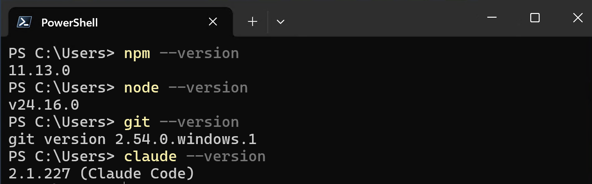
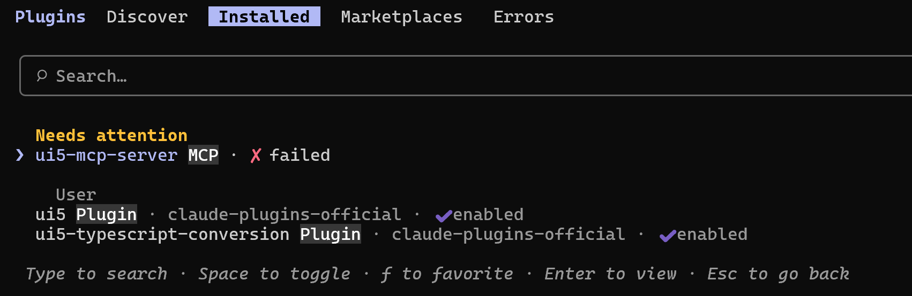

# Step 1: Getting Started — Claude Code & the UI5 Plugin (10 min)

[Back to Overview](../../README.md) | [Next: Step 2 — Create & enhance a JS app →](../02/README.md)

In this step you install **Claude Code**, add the **UI5 plugin**, and confirm that the agent is
*grounded* — able to pull real answers from the official OpenUI5 API reference through the UI5
MCP server. Everything in the rest of the tutorial builds on this.

> 📝
> The tutorial uses **Claude Code** for all commands and examples. If you prefer
> **GitHub Copilot CLI**, the same UI5 plugin is available via
> `copilot plugin install ui5@awesome-copilot` — adapt the CLI commands accordingly.

## 1.1 Install Claude Code

Claude Code requires a **Pro, Max, Ultra, Team, or Enterprise** claude.ai account (or a Console
API key). The free plan does not include Claude Code access.

Install the CLI as a global npm package (requires Node.js 22 or later):

```bash
npm install -g @anthropic-ai/claude-code
```

> 📝
> Do not run this with `sudo`. Claude Code updates itself without elevated privileges, and a
> `sudo` install breaks that.

Verify the install:

```bash
claude --version
```

A working installation prints a version number such as `2.1.211 (Claude Code)`.

**Log in:** Run `claude` for the first time and follow the browser prompts to authenticate with
your claude.ai account. If you have an `ANTHROPIC_API_KEY` environment variable set, Claude Code
will offer to use it instead.

```bash
claude
```

## 1.2 Verify the prerequisites

Once logged in, confirm the rest of the toolchain is in place:

```bash
npm --version
node --version   # v22 or newer
git --version
claude --version
```



## 1.3 Install the UI5 plugin

The UI5 plugin bundles the **UI5 MCP server** (API reference, linter, app scaffolding) and the
UI5 best-practice skills:

```bash
claude plugin install ui5@claude-plugins-official
```

> 📝
> In rare cases the marketplace may be out of date and the plugin cannot be found.
> If that happens, refresh the marketplace first:
> ```bash
> claude plugin marketplace update claude-plugins-official
> ```
> Then re-run the install command above.

## 1.4 Launch Claude Code

From a project directory where you want to work:

```bash
claude
```

> 💡
> **Task:** Confirm the UI5 MCP server tools are available. Ask Claude Code:
> ```
> Which UI5 MCP server tools do you have available?
> ```
> You should see tools such as `get_guidelines`, `get_api_reference`, `run_ui5_linter`,
> `create_ui5_app` and many more.

> 📝
> If you restarted `claude` but the tools are still not listed, the MCP server process may have
> failed to start. Type `/plugins`, search for **ui5**, and click **Reconnect**.



## 1.5 Confirm grounding works

> 💡
> **Task:** Ask Claude Code:
> ```
> What's the latest version of OpenUI5?
> ```
>
> Watch it call the `get_version_info` tool to look up the latest OpenUI5 release.

## Verify

- [ ] `claude --version` prints a version number.
- [ ] `claude` launches and authenticates without errors.
- [ ] The UI5 MCP server tools are listed when you ask.
- [ ] Claude Code returns UI5 version info from the **UI5 MCP server**.

## Summary

You now have a grounded UI5 coding agent. In Step 2 you'll put it to work scaffolding and
enhancing a real OpenUI5 application.

***

**Next:** [Step 2: Create & enhance a new OpenUI5 application in JavaScript](../02/README.md)
