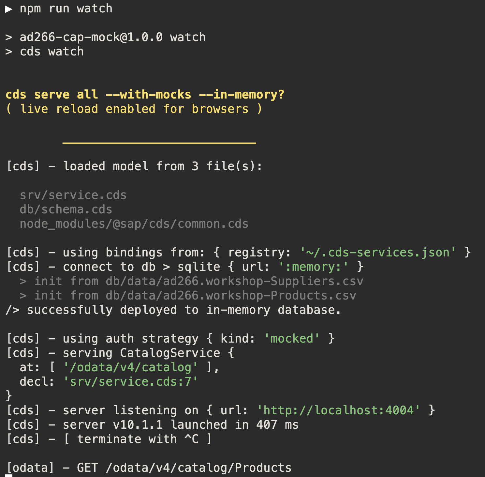
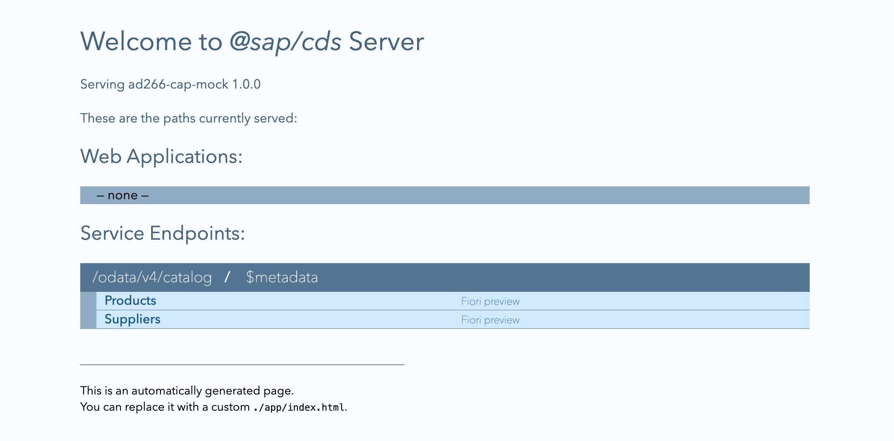
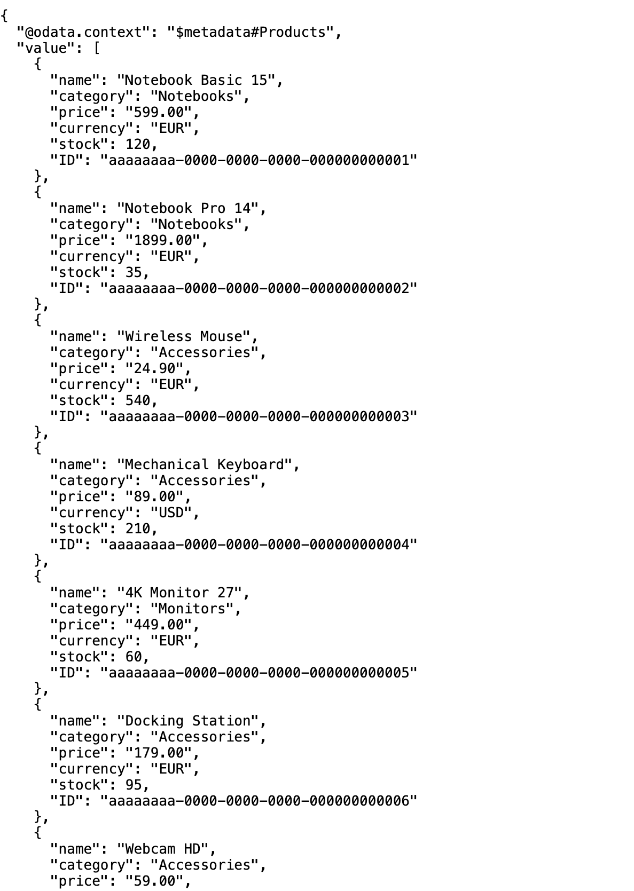

# Step 2: Create & Enhance a New OpenUI5 Application in JavaScript (40 min)

[← Previous: Step 1 — Getting Started](../01/README.md) | [Back to Overview](../../README.md) | [Next: Step 3 — Convert to TypeScript →](../03/README.md)

In this step you use Claude Code to **scaffold** a new OpenUI5 application (JavaScript) and then
**enhance** it: wire it to an OData V4 service, render an entity set in a table, add a detail form,
and add translatable texts with formatting logic. Throughout, Claude Code consults the OpenUI5 API reference and the
best-practice guidelines — you learn to *drive* it and to *review* what it produces.

## 2.1 Start the mock OData service

The backend is a CAP mock service that you start before scaffolding the app.

First, create a folder named `apps` at a location of your choice. Throughout this tutorial you'll keep every app you create or download inside this one folder.

Download [`cap-mock.zip`](apps/cap-mock.zip) into your `apps` folder. Then open a **new terminal in the `apps` folder**, unpack the archive, and start the service:

```bash
tar -xf cap-mock.zip
cd cap-mock
npm install
npm run watch
```

The service boots, deploys the seed data to an in-memory database, and serves `CatalogService`:



It serves at `http://localhost:4004`. The CAP welcome page lists the `CatalogService` with its
`Products` and `Suppliers` endpoints:



Confirm the products endpoint returns data — open
`http://localhost:4004/odata/v4/catalog/Products` (tick **Pretty-print** in the browser):



This is the data your OpenUI5 application will bind to in the steps below.

## 2.2 Scaffold the app

Open a **new terminal** in your `apps/cap-mock` folder and start a **new Claude Code session** there before scaffolding:

```bash
claude
```

> 📝
> This is a new folder, so Claude Code asks you to trust it on launch (see
> [Step 1 → section 1.4](../01/README.md#14-launch-claude-code)); confirm to proceed.

> 💡
> **Task:** Ask Claude Code to scaffold the application:
> ```
> Create a new OpenUI5 application in JavaScript with namespace `ui5.tutorial.agentic.products` inside a new `app` folder.
> Wire it to the OData V4 service at `http://localhost:4004/odata/v4/catalog/` and the `Products` entity set.
> Configure `cds-plugin-ui5` (https://github.com/ui5-community/ui5-ecosystem-showcase/tree/main/packages/cds-plugin-ui5) so the OpenUI5 app is served alongside the CAP service.
> ```

Inspect the generated project. Notice the modern defaults the tool applies:

- `webapp/index.html` bootstraps via `ComponentSupport` (no inline script).
- `webapp/manifest.json` declares the OData V4 data source and model.
- `webapp/Component.js`, a view, and a controller wired with `sap.ui.define`.

> 💡
> **Task:** Run the app locally to see the scaffold:
> ```
> Start the OpenUI5 application.
> ```
> Open the full path (e.g. `http://localhost:4004/ui5.tutorial.agentic.products/index.html`) — the dev server does not serve a
> default index.

## 2.3 Render the products in a table

> 💡
> **Task:** Ask Claude Code:
> ```
> In the main view, show the `Products` entity set in a `sap.m.Table` with columns for name,
> category, price (formatted as currency) and stock. Use data binding, and load the best-practice
> table guidelines first.
> ```

Things to check as it works:

- It calls the `get_api_reference` tool of the UI5 MCP server for `sap.m.Table` / `sap.m.Column` and consults the table best-practice rules.
- The `price` column uses a built-in OData type (`sap.ui.model.odata.type.Currency` or
  `Decimal` with `formatOptions`) rather than a hand-rolled formatter.
- The binding path targets the `Products` set from the OData V4 model.

## 2.4 Add a detail form

> 💡
> **Task:** Ask Claude Code:
> ```
> When a table row is selected, navigate to a details screen and show the product's details in a form: name,
> description, category, price and stock. Follow the OpenUI5 form guidelines.
> ```

Review against the guidelines: it must use `sap.ui.layout.form.Form` with a
`sap.ui.layout.form.ColumnLayout` (**never** `SimpleForm` unless you ask for it), defaulting to
2 columns on M-size.

## 2.5 Leverage translatable texts and a formatter

> 💡
> **Task:** Ask Claude Code:
> ```
> Move the column headers and labels into the i18n resource bundle, and add a formatter that
> shows 'Low stock' when stock is below 50. Apply CSP-safe async module loading and keep all locale
> files in sync.
> ```

Confirm:

- New keys are added to **every** `i18n*.properties` file, not just the default bundle.
- The formatter is loaded via `sap.ui.define` (JS) and referenced from the view via `core:require`
  — no globals, no inline script.

## 2.6 Offer support for an additional language

> 💡
> **Task:** Ask Claude Code:
> ```
> Add Spanish as a supported language. Translate all existing i18n keys into Spanish, register `es`
> as a supported locale in the manifest, and make sure the app still works for users who don't speak Spanish.
> ```

OpenUI5's resource bundle resolves locale files by matching the browser language against the `supportedLocales` you declare. A Spanish-speaking user gets `i18n_es.properties`; everyone else falls back to the default `i18n.properties`. Claude Code should derive the correct file name, locale code, and manifest structure from the OpenUI5 best-practice guidelines.

Confirm:
- `webapp/i18n/i18n_es.properties` is present and contains a Spanish translation for **every** key defined in `i18n.properties` — not just the keys added in this step.
- `manifest.json` → `sap.ui5/models/i18n/settings` declares:
  - `"supportedLocales": ["en", "es", ""]` — the empty string `""` registers the default bundle.
  - `"fallbackLocale": ""` — ensures users with unsupported locales still see the default text.
- Appending `?sap-language=es` to the URL loads the Spanish texts in the running app.

## Verify

- [ ] The app runs locally and shows products from the mock service.
- [ ] Selecting a row populates the detail form.
- [ ] The UI5 linter is clean on the new code:
      *Run the UI5 linter on the app and report the findings.* (you can see the `run_ui5_linter` tool call in its output).
- [ ] `manifest.json` is valid. (you can see the`run_manifest_validation` tool call in its output).

## Summary

You scaffolded and enhanced a real OpenUI5 application by driving a grounded agent, and you verified the
result with the UI5 linter. In Step 3 you'll convert this JavaScript app to TypeScript.

***

**Previous:** [Step 1: Getting Started](../01/README.md)

**Next:** [Step 3: Convert a JavaScript OpenUI5 Project to TypeScript](../03/README.md)
